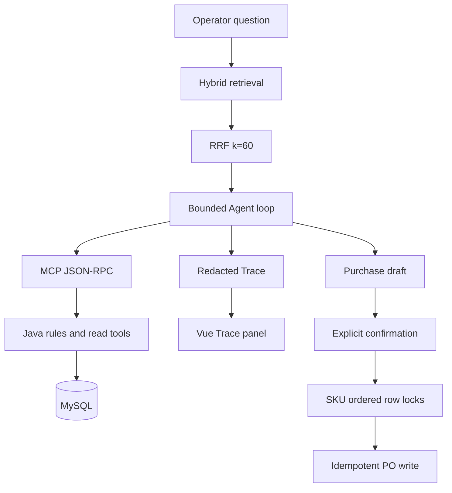

# Core modules

This map identifies the production boundaries and the evidence used to review them.

| Layer | Module | Responsibility | Review evidence |
| --- | --- | --- | --- |
| Retrieval | `fastapi-service/app/rag/hybrid.py` | Lexical + deterministic vector retrieval, RRF `k=60` | `fastapi-service/evals/hybrid_ablation.py`, `tests/test_hybrid.py` |
| Agent | `fastapi-service/app/agent/orchestrator.py` | Bounded loop, prompt layers, tool policy, stop reasons | `tests/test_orchestrator_loop.py`, `tests/test_total_budget.py` |
| MCP | `fastapi-service/app/api/mcp.py` | Authenticated JSON-RPC Streamable HTTP; 5 read-only tools / 3 resource templates | `tests/test_mcp.py`, `contracts/tools-schema.json` |
| Business rules | `java-app/.../ReplenishRules.java` | Deterministic safety stock, lead time, protection window and case-pack math | `java-app/src/test/.../ReplenishRulesTest.java` |
| Writes | `java-app/.../PoWriteService.java` | SKU-sorted row locks, pending conflict checks, idempotency | `java-app/src/test/.../CreatePurchaseOrderConcurrencyTest.java` |
| Trace | `fastapi-service/app/agent/events.py`, `live_trace.py` | Redacted event stream, credential isolation, timing and schema verdicts | `tests/test_live_trace.py`, `tests/test_trace_governance.py` |
| Web | `web-app/src/components/AgentTracePanel.vue` | Trace and audit presentation for operators | `web-app/tests/agent-trace.test.js`, `audit-panel.test.js` |
| Persistence | `db/schema.sql`, `db/seed.sql` | Demo schema, deterministic seed and reset data | `java-app/src/test/.../SchemaSeedSmokeTest.java` |

## Runtime path

## Protocol surface

The MCP endpoint is authenticated and stateless. `tools/list` advertises exactly five read tools: stock level, sales, replenishment suggestion, form record, and form run. `resources/templates/list` advertises exactly three JSON resources for stock, sales windows, and form records. Write operations stay behind Java confirmation endpoints.

## Deterministic replenishment and concurrency

The model proposes intent; `ReplenishRules` calculates quantities from current stock and policy inputs. On confirmation, the Java transaction sorts requested SKUs, locks those rows in that order, checks pending intents and the idempotency digest, then writes or replays the same purchase order. This makes retries safe and prevents lock-order deadlocks between concurrent requests.

## Trace and verification

Each run emits route, four context layers, retrieval references, tool parameter names, schema verdict, latency and stop reason. Trace data is scoped to the exact credential hash and redacted before persistence. The verification matrix contains 33 fixed replay cases and 73 E2E/integration checks, plus MCP SDK smoke, RRF ablation and browser/Trace isolation checks. Generated logs and reports belong under ignored `docs/internal/` or `artifacts/`.

## License and publication boundary

The repository keeps the top-level MIT `LICENSE` unchanged. No separate NOTICE file is present. Internal audit output is excluded by `.gitignore` (`/docs/internal/` and `/artifacts/`) so public source distribution contains implementation, contracts and reproducible commands without private audit payloads.
