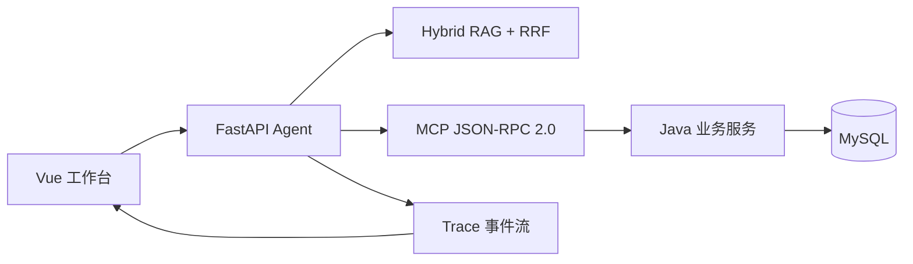

# Supply Chain Ops Agent

## 1. 项目定位与核心架构

Supply Chain Ops Agent 将库存、销量、补货决策和采购表单核验串成一条可审计工作流。Vue 工作台调用 FastAPI Agent；Agent 通过 Hybrid RAG 提供业务上下文，再经 MCP Streamable HTTP 访问 Java 业务服务和 MySQL。写入边界由 Java 服务掌控，Trace 事件回流到工作台。



## 2. 核心能力与安全边界

- **Hybrid RAG / RRF**：使用 512 维确定性特征哈希向量、四层词法规则（别名、停用词、标题权重、特征词准入）与 RRF 倒数秩融合；它不是训练型 Embedding，改写集只作为回归审计集。Hybrid 在开发集 30/30、改写集 12/12，Recall@3 为 1.0，forbidden 为 0，详见[静态消融结果](docs/eval/hybrid-ablation.json)。实时库存与销量强制通过 Java 工具现查现取，工具返回是唯一可信的实时数据源；检索文档隔离注入 `<参考文档>` 区块并声明为非执行指令。
- **MCP 契约**：Streamable HTTP 上提供 5 个只读工具、2 个固定 Resource 和 3 个 Resource template（即 3 个 Resource 模板）；请求统一校验 Bearer、Origin、协议版本、参数 Schema 和工具 ACL。MCP 不暴露业务写工具。
- **确定性补货**：`ReplenishRules` 根据库存、需求速度、安全库存、提前期、保护期和整箱箱规计算建议量；模型只生成待确认草稿。
- **受控采购写入**：创建采购单时按 SKU 固定顺序获取行锁，配合 pending 冲突检查和幂等键，避免跨用户重复建单。
- **Trace 与审计**：Trace 记录四层 Prompt、检索引用、工具 Schema、耗时、校验结果和 stop reason，并按凭证哈希隔离；敏感凭证和业务正文不落盘。

## 3. 工作台界面截图


## 4. 核心源码导航

| 模块 | 位置 |
| --- | --- |
| Hybrid RAG / RRF | [fastapi-service/app/rag/hybrid.py](fastapi-service/app/rag/hybrid.py) |
| MCP 端点与 5 tools / 2 fixed resources / 3 Resource templates | [fastapi-service/app/api/mcp.py](fastapi-service/app/api/mcp.py) |
| 工具契约 | [contracts/tools-schema.json](contracts/tools-schema.json) |
| 受限 Agent loop | [fastapi-service/app/agent/orchestrator.py](fastapi-service/app/agent/orchestrator.py) |
| Trace 事件与隔离 | [fastapi-service/app/agent/live_trace.py](fastapi-service/app/agent/live_trace.py) |
| 确定性补货 | [java-app/src/main/java/com/demo/supplyagent/service/ReplenishRules.java](java-app/src/main/java/com/demo/supplyagent/service/ReplenishRules.java) |
| SKU 行锁与幂等写入 | [java-app/src/main/java/com/demo/supplyagent/service/PoWriteService.java](java-app/src/main/java/com/demo/supplyagent/service/PoWriteService.java) |
| 评测入口 | [fastapi-service/evals/run.py](fastapi-service/evals/run.py) |

## 5. 本地启动与验证

```powershell
python scripts/demo.py prepare
python scripts/demo.py init-db
python scripts/demo.py start
python scripts/verify.py
python scripts/e2e.py
node scripts/browser_smoke.mjs
python scripts/agent-upgrade-smoke.py
python fastapi-service/evals/hybrid_ablation.py
```

验证口径：33 条固定用例的离线协议回放 + 73 条 E2E/集成回归，另含 MCP 官方 SDK smoke、Hybrid RAG 消融和 Trace 隔离检查。Hybrid 静态结果与数据摘要见 [docs/eval/hybrid-ablation.json](docs/eval/hybrid-ablation.json)；架构、协议面和验证矩阵见 [docs/architecture.md](docs/architecture.md)。

MIT 许可证见 [LICENSE](LICENSE)。仓库当前没有额外 NOTICE 文件；版权和许可文本以顶层 LICENSE 为准。
