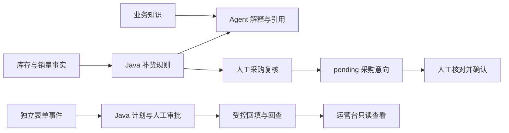

# 业务链路与口径

## 场景

运营人员发现某 SKU 库存偏低，需要知道「何时的数据、近期卖多少、为何建议这些数量、是否已有待处理采购」。随后由人作采购决定。发货准备由另一套既有表单负责，运营工作台只查询，不借采购确认跨越审批边界。



图中采购与发货准备没有自动写入连接。共享 SKU 用于人工核对，不构成订单关联或全链路追踪。真实集成的是鉴权后的表单记录/执行记录 HTTP 查询。

## 补货公式

固定业务截止日为 **2026-09-03**；7 日窗口为 **2026-08-28 至 2026-09-03**。展示时不能说成实时库存。

```text
protectionDays = max(targetCoverDays, leadDays)
reviewDays = protectionDays - leadDays
targetQty = ceil(avgDailyQty * protectionDays + safetyQty)
rawGap = max(0, targetQty - currentQty)
suggestedQty = ceil(rawGap / pkgQty) * pkgQty  # rawGap=0 则为0
```

`targetCoverDays` 已包含交货提前期，不再次相加。`reviewDays` 是解释性差值，不代表实现了周期性自动订货。紧急度按当前库存和提前期需求判断，与整箱后的数量分开。

AUD-001：现存18，日均约2.14，安全库存60，提前期7，总覆盖14，箱规24 → 目标90，缺口72，建议72。种子库已有数量96的 pending 意向，因此创建新意向必须409并展示既有单据，而非覆盖或重复创建。

DEM-001：独立合成商品，现存5，日均2，安全库存20，提前期7，覆盖14，箱规12 → 目标48，缺口43，建议48；无初始 pending，可演示完整人工创建与确认。

## 决策边界

- 缺失实际返回的库存/销量/商品策略：计算量为空，`insufficient_data`。
- 日期错位、覆盖短于提前期、商品下架等：`review_required`，需要人核实。
- 已有商品在窗口内无订单记录仍按0销量处理；尚不能识别「真实零需求」与「采集缺数」。
- 只计算库存快照，不扣预留、不计在途，也未实现收货/入库。
- 采购创建按包装倍数等硬规则校验，不把建议量当成不可更改指令。模型或前端不能替代服务端规则。

## 状态、并发与失败

创建意向时按 SKU 顺序锁定商品行，先处理相同幂等键回放，再判断既有 pending；批量有冲突则整体不写。确认按单号做条件状态迁移，重复确认409。已确认订单尚无到货核销流程，系统不声称阻止所有重复采购。

前端先保存原始内容与幂等键，再发送。网络断开或5xx不等于失败，页面锁定原内容并保留到刷新后，用户先查单、再以原键重试。明确成功或拒绝后可人工开始新意向；浏览器存储不可写则不发送创建请求。

表单服务停止时适配器返回503，库存业务仍可独立使用。适配器仅允许两个固定 GET 路径和固定格式标识，不转发用户 JWT、不代理审批或写入。表单 H2 是内存库，重启会重置数据。
