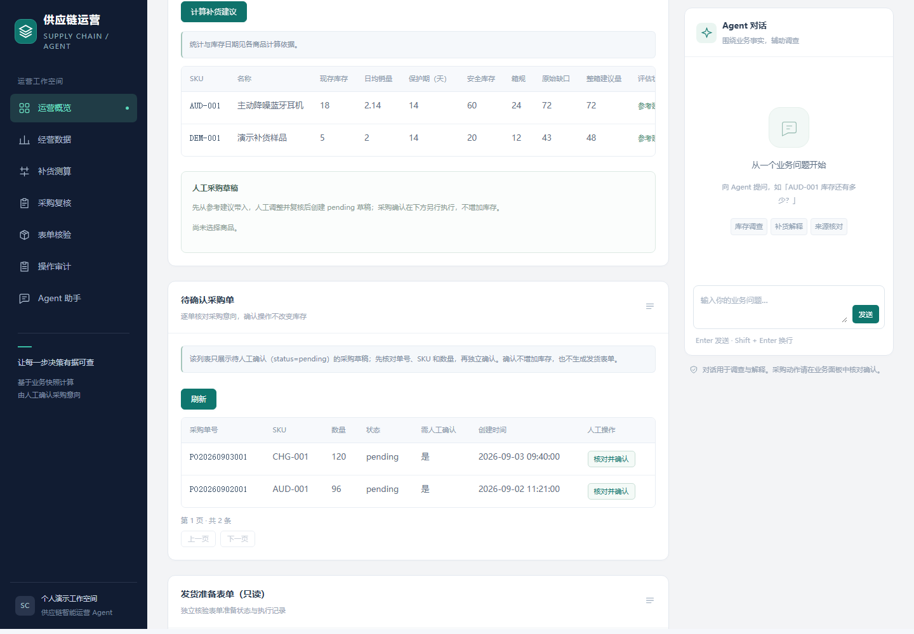
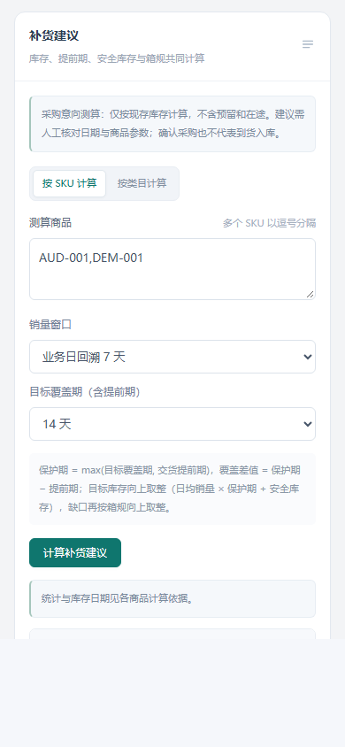
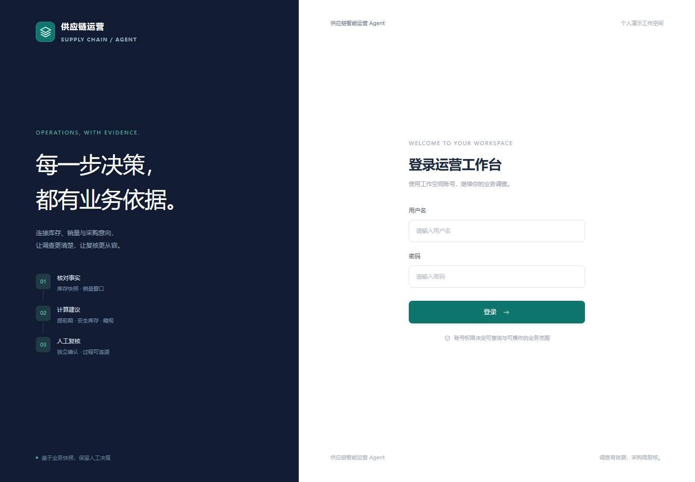

# 供应链运营工作台界面更新

日期：2026-10-21。

布局参考：[Tabler Dashboard](https://preview.tabler.io/?theme=light)、[shadcn Dashboard](https://ui.shadcn.com/examples/dashboard)。参考其导航、内容层次、表格与表单组织，在现有技术栈中实现，未新增UI框架、CDN字体或远程图片依赖。

青绿强调经营数据调查和人工采购复核。新增真实模块锚点导航，库存与销量查询分组，补货及采购复核单独分区，Agent保持独立对话区；全部已有业务模块保留。

统一使用深蓝侧栏、白色页头、浅灰内容画布、细边卡片与清晰状态标签。中文正文、输入和业务数据保留可读字号，390px下表单改单列，宽表格在各自容器内滚动。导航只连接已有业务区或实际页面，不填充虚构指标和趋势图。

截图来自真实本机服务及合成数据。统一截图复核的桌面1440px、手机390px均满足 `scrollWidth == innerWidth`，无未处理页面异常；此结果不是生产压测或真实模型效果评测。

## 本轮验证

149项前端测试与生产构建通过；重启合成表单场景后，真实HTTP27项、Pi跨进程7场景73项通过，随后浏览器完成查询、重复采购拦截、人工创建与确认、viewer只读及当前表单运行查询。浏览器脚本会另建并确认一笔合成采购意向，不是纯截图命令。

前两个Vue项目的所有已有组件 `<script setup>` 与改版前逐一比对保持一致；业务变化不计入本轮视觉工作。CRM只新增展示状态同步。原有模型、数据库、发送与生产验收范围仍以原交付记录为准。

